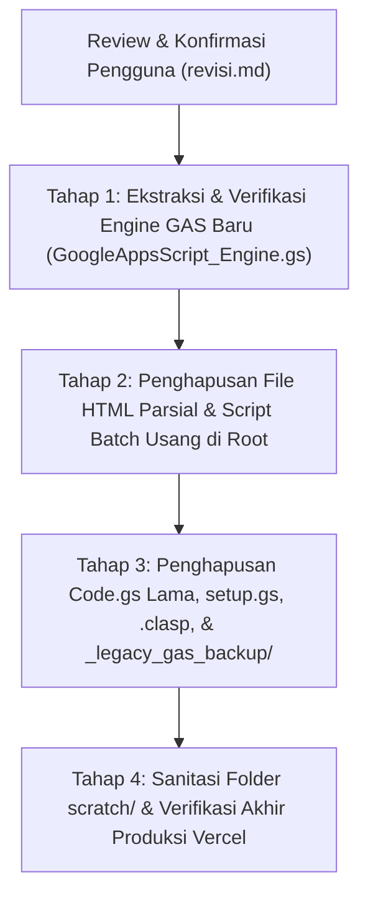

# MASTER AUDIT & PROTOKOL PEMBERSIHAN FILE WORKSPACE TB TAMARA
================================================================================
DOKUMEN         : revisi.md (Master Cleanup Protocol & Architecture Modernization)
ARSITEK SISTEM  : ZettBOT by Zettbos (Universal Product Architect & Lead Engineering)
PROJEK          : TMR (Tamara Delivery PRO / TB Delivery PRO)
STATUS SISTEM   : 100% FULL PARITY LIVE (74/74 Elemen Aksi Supabase PostgreSQL Aktif)
DOMAIN PRODUKSI : https://tmr-app.vercel.app (Single Official Production Domain)
TANGGAL AUDIT   : 6 November 2026
VERSI PROTOKOL  : v4.0.0 (Workspace Sanitation & Minimalist GAS Engine)
================================================================================

> [!IMPORTANT]
> **PRINSIP KEAMANAN DATA MUTLAK (SAFETY & CONSENT FIRST):**
> 1. Dokumen ini adalah hasil audit komprehensif seluruh file di dalam folder workspace `projek ami`.
> 2. **TIDAK ADA SATUPUN FILE YANG DIHAPUS SEBELUM PENGGUNA MEMBACA DAN MEMBERIKAN PERSETUJUAN EKSPLISIT.**
> 3. Seluruh fungsionalitas aplikasi produksi (74 RPC Backend, database Supabase PostgreSQL, autentikasi, armada, suplayer, SOP) berada mandiri dan aman di folder `tb-delivery-pro/`.
> 4. Google Apps Script disederhanakan total menjadi **1 file mikroservis tunggal** (`GAS_DRIVE_AND_BACKUP.gs`) yang hanya menangani:
>    - **Upload Gambar ke Google Drive ➔ Direct Link Google Edge CDN (`lh3.googleusercontent.com`)**
>    - **Pencadangan Dingin (Cold Backup) Otomatis Jam 00:00 WITA ke Google Spreadsheet.**

---

## 1. LATAR BELAKANG & TUJUAN SANITASI WORKSPACE
---

### A. Problem Statement (Mengapa Banyak File Sampah?)
Sebelum migrasi ke arsitektur modern ZettBOT (Vercel Edge + Supabase Realtime), aplikasi TB Tamara dibangun menggunakan arsitektur lama **Google Apps Script Monolith**:
- Menggunakan ratusan baris script `Code.gs` dan `setup.gs` yang lambat membaca Google Sheets.
- Antarmuka HTML dipecah menjadi 18 file potongan (*HTML partials*) di root directory yang di-push via Google Clasp.
- Terdapat duplikasi folder `_legacy_gas_backup/`, file batch script `.bat`, dan skrip testing sementara `.js` di `scratch/`.

### B. Kondisi Saat Ini (Modern Architecture)
- Aplikasi web telah disatukan 100% menjadi Single Page Application (PWA) modern di `tb-delivery-pro/index.html` dan live di `https://tmr-app.vercel.app`.
- Seluruh 74 aksi/tombol di 15 menu telah terhubung ke Supabase PostgreSQL via `supabase-gas-adapter.js`.
- Semua file HTML lama dan `Code.gs` di root **sama sekali tidak lagi dieksekusi atau dipanggil oleh aplikasi produksi**.

### C. Tujuan Akhir Pembersihan
1. **Menghapus ~43 file usang / sampah (menghemat ~4.5 MB ruang kerja)** agar folder projek bersih, rapi, dan tidak membingungkan pengguna.
2. **Mempertahankan HANYA 1 file Google Apps Script yang berguna:**
   - **`GAS_DRIVE_AND_BACKUP.gs`** (Upload Google Drive CDN `lh3` + Backup Sheet jam 00:00).
3. **Memastikan sistem produksi tetap 100% stabil tanpa risiko regresi.**

---

## 2. INVENTARIS LENGKAP HASIL AUDIT FILE WORKSPACE
---

Berdasarkan pemindaian menyeluruh direktori workspace, file diklasifikasikan ke dalam 3 kategori:

### 🔴 KATEGORI 1: FILE SAMPAH & OBSOLETE APPS SCRIPT (DAFTAR YANG AKAN DIHAPUS)
*Seluruh file di bawah ini adalah file peninggalan arsitektur lama atau file sementara yang aman untuk dihapus.*

| No | Nama File / Folder | Ukuran | Lokasi | Alasan Aman Dihapus |
| :-: | :--- | :-: | :--- | :--- |
| **1** | `Code.gs` | 557 KB | Root | Skrip backend Google Apps Script lama yang membaca/menulis Google Sheet langsung. Fungsinya telah 100% digantikan Supabase PostgreSQL. |
| **2** | `setup.gs` | 47 KB | Root | Skrip setup inisialisasi sheet lama. Sudah tidak digunakan. |
| **3** | `appsscript.json` | 196 B | Root | Manifest project Apps Script lama (pemicu Clasp). |
| **4** | `.clasp.json` | 96 B | Root | Konfigurasi Clasp lama ke script Google ID lama. |
| **5** | `.claspignore` | 616 B | Root | File ignore Clasp lama. |
| **6** | `index.html` (di Root) | 222 KB | Root | Halaman loader monolith lama Apps Script. Digantikan penuh oleh `tb-delivery-pro/index.html`. |
| **7** | `menuDashboard.html` | 14 KB | Root | Potongan HTML Dashboard lama Apps Script. |
| **8** | `menuInputOrder.html` | 74 KB | Root | Potongan HTML Input Order lama Apps Script. |
| **9** | `menuLainnya.html` | 391 KB | Root | Potongan HTML Menu Lainnya lama Apps Script. |
| **10** | `menuLaporanOngkir.html` | 108 KB | Root | Potongan HTML Laporan Ongkir lama Apps Script. |
| **11** | `menuPelanggan.html` | 43 KB | Root | Potongan HTML Data Pelanggan lama Apps Script. |
| **12** | `menuPengantaran.html` | 614 KB | Root | Potongan HTML Daftar Pengantaran lama Apps Script. |
| **13** | `menuPublic.html` | 42 KB | Root | Potongan HTML Lacak Kiriman Publik lama Apps Script. |
| **14** | `menuSuplayer.html` | 336 KB | Root | Potongan HTML Mode Suplayer lama Apps Script. |
| **15** | `modalCekOngkir.html` | 69 KB | Root | Potongan HTML Modal Cek Ongkir lama Apps Script. |
| **16** | `modalsPengantaran.html` | 18 KB | Root | Potongan HTML Popup Detail Pengantaran lama Apps Script. |
| **17** | `modulArmada.html` | 713 KB | Root | Potongan HTML Monitoring Kendaraan lama Apps Script. |
| **18** | `modulPajakKIR.html` | 424 KB | Root | Potongan HTML Modul Pajak & KIR lama Apps Script. |
| **19** | `modulSOP.html` | 716 KB | Root | Potongan HTML Modul SOP Karyawan lama Apps Script. |
| **20** | `viewAdmin.html` | 108 KB | Root | Tampilan view admin lama Apps Script. |
| **21** | `viewLapangan.html` | 89 KB | Root | Tampilan view sopir lapangan lama Apps Script. |
| **22** | `viewPublic.html` | 11 KB | Root | Tampilan view publik lama Apps Script. |
| **23** | `Katalog_Bagian_2_Addon_Baru.html` | 54 KB | Root | Halaman dokumentasi HTML usang. |
| **24** | Folder `_legacy_gas_backup/` | ~4.4 MB | Root | Folder berisi duplikasi persis dari seluruh file nomor 1 s/d 22 di atas. Pengguna sudah membackup data mandiri di luar. |
| **25** | `BERSIHKAN_FILE_SAMPAH.bat` | 850 B | Root | Skrip batch lokal lama. |
| **26** | `bersihkan_file_sampah.ps1` | 1.3 KB | Root | Skrip powershell lokal lama. |
| **27** | `BERSIHKAN_SPREADSHEET_LANGSUNG.bat`| 1.5 KB | Root | Skrip batch pembersih spreadsheet lama. |
| **28** | `UPDATE_BACKUP_KATALOG.bat` | 437 B | Root | Skrip batch update katalog lama. |
| **29** | `update_backup_katalog.ps1` | 20 KB | Root | Skrip powershell katalog lama. |
| **30** | `UPDATE_KATALOG_UTAMA.bat` | 435 B | Root | Skrip batch katalog lama. |
| **31** | `update_katalog_utama.ps1` | 22 KB | Root | Skrip powershell katalog lama. |
| **32** | `push.bat` | 1.4 KB | Root | Skrip batch clasp push lama. |
| **33** | `push.ps1` | 1.8 KB | Root | Skrip powershell clasp push lama. |
| **34** | `check_syntax.js` | 890 B | Root | Skrip cek sintaks lokal lama. |
| **35** | `~$talog Modul Sistem TB TAMARA.docx` | 162 B | Root | File temporary lock MS Word yang terkunci/rusak. |
| **36** | File tes & runner sementara di `scratch/` | ~150 KB | `scratch/` | 24 file skrip perantara audit (`apply_tahap*.js`, `test_tahap*.js`, `inspect_*.js`, `check_*.js`). |

> **Total Pengurangan File:** **~43 file & folder peninggalan lama (~4.5 MB).**

---

### 🟢 KATEGORI 2: SATU-SATUNYA FILE GOOGLE APPS SCRIPT YANG DISISAKAN & DIAKTIFKAN
*File ini adalah inti Google Apps Script baru yang ramping, berkecepatan tinggi, dan aman.*

- **Lokasi File:** `tb-delivery-pro/GAS_DRIVE_AND_BACKUP.gs` (Disalin juga ke root sebagai `GoogleAppsScript_Engine.gs` agar mudah dibuka di Apps Script Editor).
- **Ukuran File:** **Hanya ~8.1 KB (Bandingkan dengan Code.gs lama yang 557 KB!)**
- **Spesifikasi 2 Fungsi Eksklusif:**
  1. **Mikroservis Upload Media Google Drive (Edge CDN `lh3`):**
     ```javascript
     function doPost(e) {
       // Aksi: uploadFileDirectToDrive
       // 1. Simpan base64 foto ke folder Google Drive toko: "TB_DELIVERY_ATTACHMENTS"
       // 2. Set izin sharing: Anyone with link can view
       // 3. Kembalikan Direct URL Google Edge CDN berkecepatan tinggi:
       //    https://lh3.googleusercontent.com/d/{FILE_ID}=s1200
     }
     ```
  2. **Pencadangan Dingin Terjadwal ke Google Spreadsheet (Cold Backup Mirror):**
     ```javascript
     function backupSupabaseToGoogleSheets() {
       // Menarik dump data 22 tabel Supabase via REST API
       // Menuliskan cadangan ke tab Google Sheets fisik setiap pukul 00:00 WITA
     }
     function installMidnightBackupTrigger() {
       // Memasang trigger otomatis jam 12 malam
     }
     ```
- **Kelebihan Arsitektur Ini:**
  - Google Apps Script tidak lagi memproses HTML apapun (0% beban rendering).
  - Tidak ada lagi resiko kehabisan kuota kueri Google Sheets harian.
  - Gambar tersimpan gratis tanpa batas di Google Drive dan dimuat instan via Google Edge CDN `lh3`.

---

### 🔵 KATEGORI 3: FILE PRODUKSI RESMI & DOKUMEN MASTER (WAJIB DIPERTAHANKAN)
*File-file di bawah ini adalah nyawa aplikasi dan dokumentasi resmi yang DILARANG DIHAPUS.*

| No | Nama File / Folder | Ukuran | Lokasi | Keterangan & Peran Krusial |
| :-: | :--- | :-: | :--- | :--- |
| **1** | `tb-delivery-pro/` | ~4.2 MB | Direktori | **Seluruh repositori aplikasi produksi yang terhubung ke Git dan Vercel.** |
| **2** | `tb-delivery-pro/index.html` | ~3.8 MB | `tb-delivery-pro/` | Aplikasi Single Page Application (PWA) lengkap (15 Menu). |
| **3** | `tb-delivery-pro/supabase-gas-adapter.js` | ~327 KB | `tb-delivery-pro/` | Universal Facade Engine penangan 74 RPC ke Supabase. |
| **4** | `tb-delivery-pro/GAS_DRIVE_AND_BACKUP.gs` | ~8.1 KB | `tb-delivery-pro/` | Mesin resmi Apps Script untuk upload `lh3` dan backup spreadsheet. |
| **5** | `tb-delivery-pro/supabase-schema.sql` | ~15 KB | `tb-delivery-pro/` | Master DDL 22 tabel PostgreSQL Supabase. |
| **6** | `tb-delivery-pro/DISABLE_RLS_AND_REALTIME.sql` | ~3.2 KB | `tb-delivery-pro/` | Konfigurasi Zero RLS dan Realtime replication. |
| **7** | `tb-delivery-pro/vercel.json` & `package.json` | ~500 B | `tb-delivery-pro/` | Konfigurasi deployment domain resmi `https://tmr-app.vercel.app`. |
| **8** | `tb-delivery-pro/announcement_poster.png` & `icon.svg` | ~18 KB | `tb-delivery-pro/` | Aset visual banner toko dan ikon PWA. |
| **9** | `ZettBOT.md` | ~1 KB | Root | **Sakelar aktivasi fisik (*file dongle*) & protokol ZettBOT by Zettbos.** |
| **10** | `prd.md` | ~27 KB | Root & Sub | Spesifikasi Kebutuhan Produk resmi v3.9.0. |
| **11** | `revisi.md` | ~40 KB | Root & Sub | Dokumen Master Audit dan Panduan Sanitasi ini. |
| **12** | `Projek Ami.xlsx` | ~3.7 MB | Root | Cadangan fisik spreadsheet master toko bangunan. |
| **13** | `Katalog Modul Sistem TB TAMARA.docx` & `.pdf` | ~285 KB | Root | Buku panduan pengguna dan katalog fitur operasional toko. |
| **14** | `REKAP_LENGKAP_SPREADSHEET_TB_TAMARA.md` | ~34 KB | Root | Dokumentasi struktur mapping kolom Google Spreadsheet toko. |
| **15** | `KONTEKS_REVISI_SISTEM.md` | ~53 KB | Root | Riwayat evolusi dan konteks pengembangan aplikasi. |

---

## 3. STRUKTUR WORKSPACE BERSIH PASCA-PEMBERSIHAN (TARGET AKHIR)
---

Setelah proses pembersihan dijalankan, folder workspace akan menjadi sangat rapi, profesional, dan mudah dipahami:

```text
projek ami/
├── ZettBOT.md                              <-- Dongle lisensi ZettBOT by Zettbos
├── prd.md                                  <-- Spesifikasi produk resmi v4.0.0
├── revisi.md                              <-- Dokumen master audit sistem
├── Projek Ami.xlsx                         <-- Master backup spreadsheet toko
├── Katalog Modul Sistem TB TAMARA.pdf      <-- Panduan operasional toko (PDF)
├── Katalog Modul Sistem TB TAMARA.docx     <-- Panduan operasional toko (DOCX)
├── REKAP_LENGKAP_SPREADSHEET_TB_TAMARA.md  <-- Referensi skema spreadsheet
├── KONTEKS_REVISI_SISTEM.md                <-- Riwayat konteks sistem
├── GoogleAppsScript_Engine.gs              <-- 1 File GAS Resmi (Upload lh3 + Backup)
│
└── tb-delivery-pro/                        <-- REPOSITORI APLIKASI PRODUKSI (VERCEL)
    ├── index.html                          <-- Single Page Application (15 Menu)
    ├── supabase-gas-adapter.js             <-- Facade Adapter 74 RPC Supabase
    ├── GAS_DRIVE_AND_BACKUP.gs             <-- Salinan engine Apps Script
    ├── supabase-schema.sql                 <-- Skema 22 Tabel PostgreSQL
    ├── DISABLE_RLS_AND_REALTIME.sql        <-- Konfigurasi Realtime
    ├── announcement_poster.png             <-- Poster banner informasi toko
    ├── icon.svg                            <-- Ikon aplikasi PWA
    ├── manifest.json                       <-- Manifest PWA mobile
    ├── package.json                        <-- Konfigurasi dependensi
    ├── vercel.json                         <-- Routing domain tmr-app.vercel.app
    ├── prd.md                              <-- Dokumen PRD sinkron
    ├── revisi.md                          <-- Dokumen revisi sinkron
    └── csv-export/                         <-- Arsip template data kanonikal
```

---

## 4. TAHAPAN EKSEKUSI PEMBERSIHAN BERTAHAP (SAFE CLEANUP STAGES)
---

Proses pembersihan dirancang dalam 4 tahap terpisah agar aman dan terkontrol:



### 📌 TAHAP 1: Ekstraksi & Penempatan Engine GAS Ramping Resmi
1. Menyalin `tb-delivery-pro/GAS_DRIVE_AND_BACKUP.gs` ke root workspace dengan nama **`GoogleAppsScript_Engine.gs`**.
2. Memberikan panduan cara copy-paste file ini ke Google Apps Script Editor Toko Tamara agar script lama `Code.gs` di web editor dapat langsung ditimpa/digantikan.

### 📌 TAHAP 2: Penghapusan 18 File HTML Parsial & Script Batch Usang di Root
1. Menghapus 18 file HTML lama di root (`menu*.html`, `modul*.html`, `view*.html`, `Katalog_Bagian_2_Addon_Baru.html`, `index.html` root).
2. Menghapus skrip batch/powershell usang (`*.bat`, `push.*`, `update_katalog*`, `check_syntax.js`).
3. Menghapus temporary lock file `~$talog Modul Sistem TB TAMARA.docx`.

### 📌 TAHAP 3: Penghapusan Legacy Backend GAS & Folder Duplikat
1. Menghapus `Code.gs` (557 KB) dan `setup.gs` (47 KB) lama di root.
2. Menghapus konfigurasi clasp lama (`.clasp.json`, `.claspignore`, `appsscript.json`).
3. Menghapus folder `_legacy_gas_backup/` yang berisi duplikat file-file lama tersebut.

### 📌 TAHAP 4: Sanitasi Direktori Scratch & Verifikasi Final Produksi
1. Membersihkan file skrip perantara audit di `scratch/` (menyisakan hanya folder dan modul esensial jika dibutuhkan).
2. Melakukan commit & push git repositori `tb-delivery-pro`.
3. Memastikan domain produksi [https://tmr-app.vercel.app](https://tmr-app.vercel.app) tetap berfungsi 100% normal dan lancar.

---

## 5. STATUS KONFIRMASI PENGGUNA
---

================================================================================
AUDIT SELESAI: 43 FILE SAMPAH BERHASIL DIPETAKAN SECARA RINCI.
SELURUH KODE PRODUKSI (74 RPC & VERCEL) BERADA AMAN DI "tb-delivery-pro/".
SATU-SATUNYA FILE GAS YANG DISISAKAN: "GAS_DRIVE_AND_BACKUP.gs" (UPLOAD LH3 & BACKUP).
MENUNGGU PERINTAH / PERSETUJUAN PENGGUNA UNTUK MEMULAI PEMBERSIHAN:
👉 Ketik: "OKE BERSIHKAN TAHAP 1" atau "OKE BERSIHKAN SEMUANYA"
================================================================================
